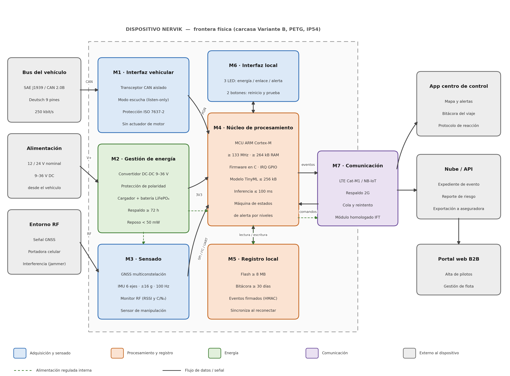

# Semana 5 · Diseño de producto: PDS y arquitectura del sistema

## Objetivo de la semana

Convertir la idea de Nervik en requisitos técnicos medibles y verificables, y definir cómo se conectan sus componentes.

| | |
|---|---|
| **Proyecto** | Nervik: sistema de monitoreo autónomo anti-interferencia para autotransporte de carga |
| **Equipo** | Equipo 2: Andrik, Juan Pablo y Mauro |
| **Versión** | 1.0, 2 de octubre de 2026 |

## 1. Definición del producto

Nervik es un dispositivo embebido que se instala en la cabina del tractocamión, se conecta al bus de diagnóstico y procesa telemetría **de forma local**. Detecta la pérdida deliberada de señal provocada por jammers, guarda un **registro inalterable** de lo ocurrido mientras no hay conectividad y alerta al centro de control cuando la comunicación regresa. La detección usa TinyML en el propio dispositivo, sin depender de la nube.

### Exclusiones del alcance

Son decisiones de diseño, no omisiones:

- **Sin paro ni bloqueo de motor.** El dispositivo solo escucha el bus y nunca inyecta tramas, lo que elimina el riesgo de una condición insegura en movimiento.
- Sin actuar sobre frenos, dirección, transmisión ni otros sistemas críticos.
- Sin sensado dentro del remolque (se deja una interfaz reservada para el futuro).
- Sin recálculo de ruta: la decisión la toma el centro de control.

!!! warning "Corrección técnica"
    Los tractocamiones usan **SAE J1939 con conector Deutsch de 9 pines**, no el OBD-II de 16 pines de los autos. La PDS adopta J1939 como interfaz principal y deja el adaptador OBD-II solo para banco de pruebas.

## 2. Usuario y contexto de uso

| Aspecto | Definición |
|---|---|
| Comprador | Dueño de flota o gerente de seguridad de una transportista mediana (20 a 200 tractocamiones) |
| Operador | Personal del centro de monitoreo, que recibe las alertas y ejecuta el protocolo |
| Afectado | El chofer, que no interactúa con el dispositivo durante la marcha |
| Beneficiario indirecto | Aseguradora o broker, que recibe el expediente del evento como evidencia |
| Corredores | México–Puebla–Veracruz, México–Querétaro y el Bajío |
| Instalación | Detrás o debajo del tablero, fuera de la vista y del alcance del chofer |
| Condiciones | Vibración, calor por asoleamiento, variación de tensión al arrancar y cobertura celular intermitente |

## 3. Especificación de Diseño de Producto (PDS)

Prioridad: **O** = obligatorio (si no se cumple, el producto no sirve) · **D** = deseable (negociable frente a costo o plazo).

=== "Desempeño"

    | N.º | Requisito | Valor objetivo | Prio. | Verificación |
    |---|---|---|:-:|---|
    | F-01 | Detección de interferencia RF | ≤ 5 s desde el inicio hasta la clasificación | O | Cámara con generador de RF |
    | F-02 | Falsos positivos | ≤ 1 por cada 1,000 km en ruta mixta | O | Prueba en campo con bitácora comparada |
    | F-03 | Criterio multiseñal | ≥ 3 señales simultáneas (C/N₀ de GNSS, RSSI celular, tramas J1939, IMU) | O | Revisión de firmware |
    | F-04 | Inferencia local | ≤ 100 ms por ventana | O | Temporizador en el MCU |
    | F-05 | Operación sin conectividad | 100 % de detección y registro sin enlace celular | O | Prueba con módem deshabilitado |
    | F-06 | Posicionamiento | ≤ 5 m CEP; TTFF en caliente ≤ 2 s | O | Contra referencia GNSS |
    | F-07 | Posición durante el bloqueo | Deriva por IMU ≤ 200 m tras 60 s sin GNSS | D | Trayecto conocido |
    | F-08 | Alertas por niveles | Tres niveles con acción definida | O | Prueba de máquina de estados |
    | F-09 | Transmisión diferida | 100 % de eventos en ≤ 60 s al recuperar enlace | O | Prueba de reconexión |

=== "Interfaces"

    | N.º | Requisito | Valor objetivo | Prio. | Verificación |
    |---|---|---|:-:|---|
    | I-01 | Interfaz con el vehículo | J1939 sobre CAN 2.0B, Deutsch 9 pines, 250 kbit/s (soporte 500) | O | Prueba en unidad real |
    | I-02 | Modo del bus | Solo escucha: cero tramas transmitidas | O | Analizador CAN |
    | I-03 | Parámetros leídos | Velocidad, RPM, freno, odómetro, combustible | O | Decodificación de PGN |
    | I-04 | Comunicación | LTE Cat-M1 / NB-IoT con respaldo 2G, SIM multioperador | O | Registro en red |
    | I-05 | Interfaz local | 3 LEDs (energía, enlace, alerta) y 2 botones (reinicio, autoprueba) | O | Inspección |
    | I-06 | Expansión | Puerto reservado para sensor de remolque | D | Esquemático |
    | I-07 | Servicio | Actualización remota (FOTA) con reversión | D | Prueba de actualización |

=== "Energía"

    | N.º | Requisito | Valor objetivo | Prio. | Verificación |
    |---|---|---|:-:|---|
    | E-01 | Tensión de entrada | 12/24 V; rango 9 a 36 V DC | O | Fuente variable |
    | E-02 | Consumo en operación | ≤ 2 W promedio | O | Analizador de potencia |
    | E-03 | Consumo en reposo | ≤ 50 mW con motor apagado | O | Analizador de potencia |
    | E-04 | Autonomía con batería | ≥ 72 h registrando sin alimentación del vehículo | O | Prueba de descarga |
    | E-05 | Protección eléctrica | Polaridad, sobretensión y transitorios (ISO 7637-2) | O | Prueba de pulsos |
    | E-06 | Detección de desconexión | Evento y alerta ≤ 10 s tras perder alimentación | O | Prueba de desconexión |

=== "Procesamiento y datos"

    | N.º | Requisito | Valor objetivo | Prio. | Verificación |
    |---|---|---|:-:|---|
    | P-01 | Procesador | ARM Cortex-M 32 bits, ≥ 133 MHz, ≥ 264 kB RAM | O | Selección de componente |
    | P-02 | Modelo de IA | TinyML ≤ 256 kB | O | Tamaño del binario |
    | P-03 | Bitácora | Flash ≥ 8 MB; ≥ 30 días sin sobrescribir | O | Prueba de llenado |
    | P-04 | Integridad | Cada evento firmado con HMAC-SHA256 y marca de tiempo | O | Verificación criptográfica |
    | P-05 | Resistencia a borrado | No se puede borrar ni editar desde el equipo ni la app | O | Intento de alteración |
    | P-06 | Reloj | Deriva ≤ 2 s/día sin GNSS | D | Contra reloj patrón |

=== "Físico y ambiente"

    | N.º | Requisito | Valor objetivo | Prio. | Verificación |
    |---|---|---|:-:|---|
    | M-01 | Dimensiones | ≤ 90 × 60 × 25 mm | O | Medición |
    | M-02 | Masa | ≤ 150 g con batería | O | Pesaje |
    | M-03 | Geometría | Variante B: cuña biselada | O | Contra modelo CAD |
    | M-04 | Material | PETG liso, impresión FDM o SLA | O | Inspección |
    | M-05 | Protección | IP54 | D | Ensayo de ingreso |
    | M-06 | Montaje | Soporte con cinchos, sin perforar | O | Prueba de instalación |
    | M-07 | Discreción | Fuera de la vista del chofer y sin indicadores visibles desde fuera | O | Inspección en unidad |
    | M-08 | Vibración | Sin fallas tras ISO 16750-3 | D | Mesa vibratoria |
    | A-01 | Temperatura de operación | −10 °C a +70 °C | O | Cámara climática |
    | A-02 | Temperatura de almacenamiento | −20 °C a +85 °C | O | Cámara climática |
    | A-03 | Humedad | 5 % a 95 % sin condensación | D | Cámara climática |
    | A-04 | Altitud | Hasta 3,000 m | D | Hojas de datos |

=== "Fiabilidad y normas"

    | N.º | Requisito | Valor objetivo | Prio. | Verificación |
    |---|---|---|:-:|---|
    | R-01 | Vida útil | 5 años en servicio | O | Análisis de confiabilidad |
    | R-02 | Batería de respaldo | ≥ 1,000 ciclos con ≥ 80 % de capacidad | D | Hoja de datos |
    | R-03 | Mantenimiento | Cero intervenciones el primer año | D | Análisis de diseño |
    | R-04 | Autoprueba | Por botón, resultado en LED en ≤ 30 s | O | Prueba funcional |
    | R-05 | MTBF | ≥ 40,000 h | D | Cálculo de confiabilidad |
    | N-01 | Homologación RF | Módulo celular homologado ante el IFT | O | Certificado del proveedor |
    | N-02 | Seguridad eléctrica | NOM-001-SCFI en lo aplicable | O | Revisión y ensayo |
    | N-03 | Conservación de datos | Compatible con NOM-151-SCFI | D | Asesoría |
    | N-04 | Datos personales | LFPDPPP: aviso de privacidad y minimización | O | Revisión documental |
    | N-05 | No interferencia | No altera ningún sistema del tractocamión | O | Prueba antes/después |
    | N-06 | Falla segura | Ante falla interna queda inerte | O | Inyección de fallas |

=== "Costo e instalación"

    | N.º | Requisito | Valor objetivo | Prio. | Verificación |
    |---|---|---|:-:|---|
    | C-01 | Costo de BOM | ≤ $650 MXN por unidad (lote de 100) | O | Cotizaciones |
    | C-02 | Manufactura y ensamble | ≤ $250 MXN por unidad (lote de 100) | D | Cotización de maquilador |
    | C-03 | Precio de venta | $1,800 MXN instalado + $300 MXN/mes por servicio | D | Cartas de intención |
    | C-04 | Componentes únicos | ≤ 45 referencias | D | Conteo en BOM |
    | C-05 | Disponibilidad | Cero componentes con entrega > 8 semanas o fuente única | O | Cadena de suministro |
    | C-06 | Volumen | Piloto de 30–50 unidades; escalable a 500/año | D | Plan de manufactura |
    | C-07 | Fabricación | PCB de 2–4 capas en Altium, SMD estándar, maquilador nacional | O | Archivos de fabricación |
    | U-01 | Tiempo de instalación | ≤ 10 min, una persona, sin herramienta especial | O | Prueba cronometrada |
    | U-02 | Instalación no invasiva | Sin cortar cables, soldar ni perforar | O | Inspección |
    | U-03 | Puesta en servicio | Alta en la app en ≤ 5 min | O | Prueba con usuario |
    | U-04 | Operador | Cero acciones del chofer durante la marcha | O | Diseño de interacción |
    | U-05 | Documentación | Manual de instalación, protocolo de reacción y formato de expediente | O | Entrega documental |
    | U-06 | Exportación de evidencia | PDF y JSON/CSV con firma verificable | O | Prueba de exportación |

## 4. Arquitectura del sistema

Siete módulos dentro del dispositivo y tres elementos externos. Separarlos permite validar cada bloque por su cuenta antes de integrar.

| Módulo | Función | Consideraciones de diseño |
|---|---|---|
| **M1 · Interfaz vehicular** | Leer la telemetría del camión | Transceptor CAN aislado, protegido contra transitorios de 24 V y solo en modo escucha |
| **M2 · Energía** | Alimentar y sostener ante cortes | DC-DC de 9 a 36 V, protección de polaridad y batería LiFePO₄ de respaldo |
| **M3 · Sensado** | Observar el entorno físico y de radio | GNSS multiconstelación, IMU de 6 ejes, monitor de C/N₀ y RSSI, y sensor de apertura de carcasa |
| **M4 · Procesamiento** | Decidir localmente si hay un evento | ARM Cortex-M con firmware en C; aloja el modelo TinyML y la máquina de estados. Es el único módulo que decide |
| **M5 · Registro local** | Conservar evidencia inalterable | Flash con bitácora circular y eventos firmados y encadenados; sostiene la propuesta de valor ante la aseguradora |
| **M6 · Interfaz local** | Mostrar el estado al instalador | 3 LEDs y 2 botones |
| **M7 · Comunicación** | Enlazar con el exterior cuando se pueda | Módem LTE Cat-M1 / NB-IoT homologado con cola persistente; si falla, la detección y el registro siguen |

??? note "Interfaces entre módulos"

    | Clave | Entre | Protocolo | Características |
    |---|---|---|---|
    | IF-1 | Vehículo → M1 | CAN 2.0B / J1939 | 250 kbit/s, Deutsch 9 pines |
    | IF-2 | M1 → M4 | SPI o CAN integrado | Tramas por PGN, por interrupción |
    | IF-3 | M3 → M4 | UART, I²C, SPI | GNSS por UART, IMU por SPI a 100 Hz, monitor RF por I²C |
    | IF-4 | M4 ↔ M5 | SPI | Escritura de eventos firmados y lectura para sincronizar |
    | IF-5 | M4 ↔ M7 | UART / comandos AT | Cola de eventos, registro en red y FOTA |
    | IF-6 | M4 ↔ M6 | GPIO | LEDs y botones con antirrebote |
    | IF-7 | M2 → todos | Rieles 3V3 y 5V | Secuencia de arranque y aviso de corte a M4 |
    | IF-8 | M7 ↔ Nube | HTTPS o MQTT sobre TLS | Autenticación mutua por certificado |

## 5. Máquina de estados de alerta

La respuesta es gradual y **en ningún nivel actúa sobre el vehículo**. Solo la persistencia del patrón sube el nivel, para que los falsos positivos no destruyan la confianza del centro de control.

| Nivel | Se activa cuando | Acción | Latencia |
|---|---|---|---|
| **N0 · Normal** | Telemetría, GNSS y enlace celular presentes | Registro periódico, sin notificar | Continuo |
| **N1 · Observación** | Se degrada una sola señal | Más muestreo y marca en bitácora, sin alerta | ≤ 2 s |
| **N2 · Sospecha** | Se degradan dos o más señales con el camión en movimiento | Alerta silenciosa si hay enlace; si no, encola el evento | ≤ 5 s |
| **N3 · Evento confirmado** | Pérdida total de GNSS y celular más movimiento anómalo o desvío | Registro forense firmado, LED de alerta y envío prioritario al reconectar | ≤ 5 s |

## 6. Trazabilidad de necesidad a requisito

| Necesidad del usuario | Requisitos | Módulos |
|---|---|---|
| Seguir funcionando cuando el jammer anula GPS y celular | F-01, F-03, F-05, E-04 | M3, M4, M5 |
| Que las falsas alarmas no erosionen la confianza | F-02, F-03, F-08 | M3, M4 |
| Evidencia confiable de lo ocurrido durante la ceguera | P-03, P-04, P-05, U-06 | M4, M5 |
| No inmovilizar unidades para instalar | U-01, U-02, M-06 | M1, M2 |
| No comprometer la seguridad del chofer ni del vehículo | I-02, N-05, N-06 | M1, M4 |
| Competir con el gasto actual en rastreo y custodia | C-01, C-02, C-03 | Todos |

## 7. Riesgos de diseño

| Riesgo | Mitigación | Prioridad |
|---|---|:-:|
| El acceso a J1939 varía entre marcas y años | Validar en al menos tres marcas antes de congelar el diseño | Alta |
| Más falsos positivos de lo esperado en ruta real | Recolectar datos de ruta antes de entrenar; umbral configurable por flota | Alta |
| Módulo celular sin homologación IFT | Verificar el certificado antes de comprar; tener un módulo alterno | Alta |
| Los eventos por flota son mucho menos de lo que sugiere el mercado | Entrevistar a 8–10 gerentes de seguridad y pedir conteo de 12 meses | Alta |
| La aseguradora no acepta el expediente como evidencia | Revisar el formato con un ajustador | Media |
| El consumo en reposo descarga la batería del camión | Medir desde el primer prototipo; modo de hibernación | Media |
| El BOM supera el objetivo | Cotizar con dos distribuidores y definir sustitutos | Media |

## Conclusión

!!! tip "El requisito que condiciona a todos"
    **F-02, la tasa de falsos positivos.** Es el único que no se puede comprobar en banco y requiere kilómetros reales de ruta, así que conviene recolectar datos en paralelo con el diseño del circuito, no después.

Para la etapa de viabilidad ([semana 7](semana7.md)) se necesitan: el BOM cotizado contra C-01, la estimación del área de la PCB, el presupuesto de consumo por módulo, un plan de pruebas por requisito y una validación comercial mínima con transportistas y una aseguradora.
