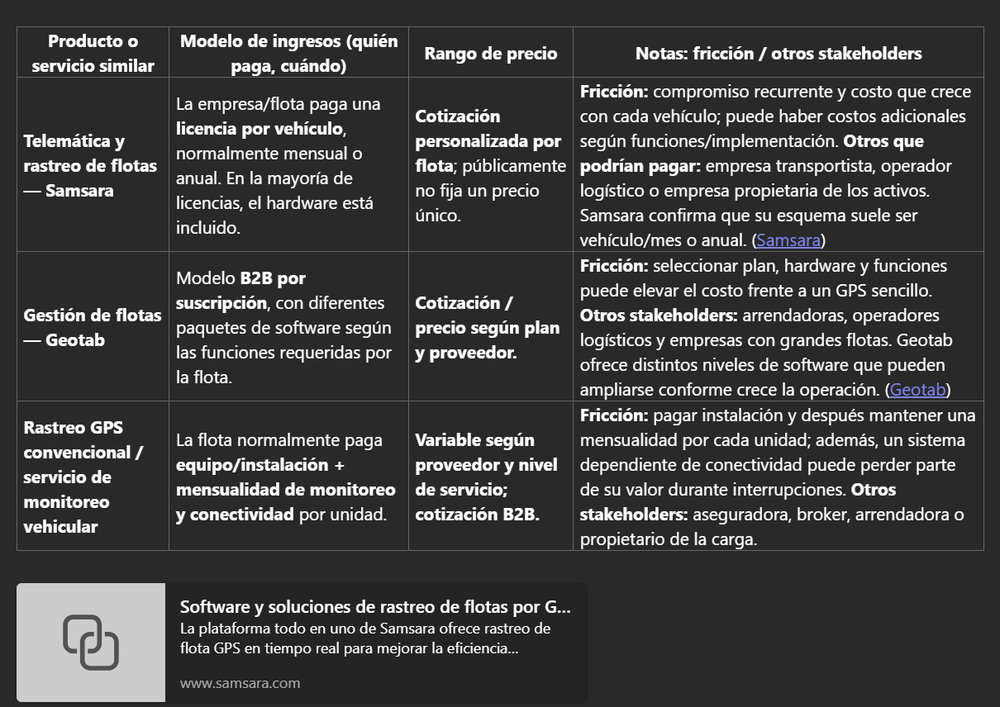

# Semana 7 · Viabilidad técnica y económica

## Objetivo de la semana

Responder si **Nervik** puede capturar valor y si la aritmética del negocio cierra: cómo cobran empresas con una oferta similar, cuánto cuesta construir el MVP de 10 unidades y dónde están los costos más fuertes.

| Pregunta de cierre | Estado |
|---|---|
| ¿Cuál es el costo unitario real a 10 unidades? | ✅ BOM ajustado de $1,531 MXN; con mejoras DFM, ≈ $867 MXN ([ver revisión DFM](../proyecto-final.md#revision-dfm)) |
| ¿Qué modelo de ingresos elegimos? | ✅ Hardware + suscripción, con la aseguradora como posible co-comprador |
| ¿Cuánto cuesta mensualmente la IA por usuario activo? | ✅ ≈ $5.30 MXN por unidad al mes ([ver cálculo](#6-costo-mensual-de-la-ia)) |
| ¿El VPN a 12 meses es positivo? | ❌ No: −$509,903 MXN. Se vuelve positivo a los 24 meses ([ver modelo](#5-modelo-financiero)) |

---

## 1. Benchmarking de modelos de ingresos

Investigamos tres empresas con una oferta similar a la de Nervik: dos plataformas de telemática y un servicio de custodia física.

| Empresa | Qué ofrece | Modelo de ingresos | Rango de precio |
|---|---|---|---|
| **Motive** (antes KeepTruckin) | Telemática y video con IA para flotas: GPS, cámaras con análisis del conductor, detección de incidentes e inmovilización remota en algunos mercados | Hardware incluido en contrato + SaaS por vehículo/mes con add-ons. Contrato mínimo anual | Sin precio público en México; ≈ USD 35 por vehículo/mes en flotas pequeñas |
| **Geotab** | Plataforma de telemática basada en el dispositivo GO: rastreo, diagnóstico del motor, comportamiento del conductor e integraciones | Hardware vendido o en comodato + SaaS por vehículo/mes (GO Core / GO Plan). Contratos típicos de 3 años | Hardware USD 80–120; software USD 20–60 por vehículo/mes. En México lo fijan los revendedores |
| **Detecta Security** | Custodia armada de mercancía en tránsito con monitoreo satelital 24/7 | Cobro por servicio o por ruta según distancia, valor de la carga y riesgo | $8,000–$15,000 MXN por ruta metropolitana; $35,000–$45,000+ MXN interestatal de alto riesgo |

??? note "Momentos de fricción y otros stakeholders"

    **Motive**

    - Precio no transparente: hay que hablar con ventas para cotizar.
    - Contrato anual mínimo, sin prueba real en corredores de alto riesgo.
    - Migrar de otro GPS implica recablear y capacitar al centro de monitoreo.
    - Vende eficiencia y seguridad general; no queda claro si protege *durante* el bloqueo con jammer o solo documenta después.
    - Otros stakeholders: aseguradoras, brokers de seguros y dueños de la carga (shippers).

    **Geotab**

    - Precio opaco y contrato de 3 años.
    - Configuración compleja (hardware, sensores IOX, reglas de alerta) para flotas medianas sin personal técnico.
    - Plataforma generalista: no resuelve la defensa autónoma sin conexión sin add-ons.
    - Otros stakeholders: integradores de seguridad, aseguradoras y programas de cumplimiento.

    **Detecta Security**

    - El costo por viaje se acumula en flotas con muchas cargas diarias.
    - El precio se negocia caso por caso, lo que complica el presupuesto.
    - Coordinar custodios, horarios y protocolos agrega fricción operativa.
    - Otros stakeholders: aseguradoras, brokers de carga, shippers y autoridades.

### Benchmarking complementario

### ¿Qué modelo predomina y por qué?

Predomina **hardware + SaaS por vehículo al mes** con contrato anual o multianual (Motive y Geotab):

- **Alineación con el activo:** el riesgo está en cada tractocamión, así que cobrar por vehículo es fácil de entender y presupuestar.
- **Recurrencia:** el margen se construye sobre la suscripción, no sobre el hardware.
- **Barrera de salida:** una vez instalado y configurado, cambiar de proveedor cuesta.
- **Escalabilidad comercial:** "seguridad por camión al mes" se vende más fácil que "protección por viaje".

La custodia cobra por servicio porque su costo principal es humano y operativo en cada traslado.

### Oportunidad: el stakeholder que no está pagando

!!! tip "Aseguradoras de carga como co-compradoras"
    Las aseguradoras (GNP, AIG, SURA, HDI, entre otras) exigen o recomiendan GPS, monitoreo y custodia, y absorben pérdidas que superan **$7,000 millones de MXN al año**. Sin embargo, ninguno de los tres modelos analizados las hace pagar por una capa de defensa autónoma sin conexión.

    Proponemos que la aseguradora pague una **cuota por póliza o por embarque** por cada unidad equipada con Nervik, a cambio de:

    - Menor siniestralidad en corredores de alto riesgo.
    - Expedientes de siniestro con evidencia registrada durante el bloqueo.
    - La posibilidad de ligar primas o deducibles al uso del dispositivo.

---

## 2. BOM del MVP (10 unidades)

**Supuesto:** MVP de 10 unidades funcionales, no un producto certificado. Precios en MXN.

=== "BOM ajustado (sin GSM)"

    | Componente | Referencia | Precio (MXN) | Proveedor sugerido |
    |---|---|---:|---|
    | Microcontrolador | ESP32-S3-WROOM-1-N8R2 (Wi-Fi/BLE) | $199 | AG Electrónica |
    | CAN Bus / OBD-II | MCP2515 + TJA1050 | $92 | Lionchip México |
    | Detección RF / jammer | Módulo RF 315/433 MHz + antena (RSSI) | $85 | AliExpress / AG Electrónica |
    | Respaldo LoRa | SX1276/SX1278 433/915 MHz | $180 | AliExpress / AG Electrónica |
    | Memoria local | Flash SPI W25Q128JV 16 MB | $45 | Mouser / DigiKey |
    | RTC | DS3231 + CR2032 | $60 | AG Electrónica / Steren |
    | Regulación automotriz | Buck LM2596HV + LDO AMS1117 | $70 | AG Electrónica |
    | Protección eléctrica | TVS SMBJ33A, PTC, Schottky, capacitores | $55 | AG Electrónica |
    | Pasivos SMD | Resistencias, capacitores, cristal, JST | $90 | JLCPCB / Mouser |
    | LEDs y buzzer | LED RGB, LED de estado, buzzer 85 dB | $35 | Steren |
    | Conector OBD-II | 16 pines, grado automotriz | $120 | AliExpress |
    | Antena LoRa | 433/915 MHz, U.FL/SMA | $70 | AliExpress |
    | Respaldo de energía | CR2032 + supercapacitor 1 F | $45 | Steren |
    | PCB 2 capas | JLCPCB, 80 × 60 mm | $95 | JLCPCB |
    | Ensamble SMT | JLCPCB Economic PCBA | $180 | JLCPCB |
    | Envío internacional | DHL/FedEx desde China | $250 | JLCPCB |
    | **Subtotal por unidad** | | **$1,531** | |

=== "BOM inicial (con GSM)"

    Igual al ajustado, más un módulo **SIM800L** para ráfaga SOS celular ($147) y su **antena GSM** ($60).

    **Subtotal por unidad: $1,810 MXN.**

!!! warning "Por encima del objetivo"
    El objetivo era **$800–$1,200 MXN por unidad**. Aun sin GSM, el BOM queda en $1,531. Para bajarlo hay que quitar LoRa, usar una PCB más pequeña o un MCU más barato. La [revisión DFM](../proyecto-final.md#revision-dfm) lo baja a ≈ $867 MXN.

---

## 3. Costos de desarrollo

| Rubro | Detalle | Costo (MXN) |
|---|---|---:|
| Firmware embebido en C/C++ | Lectura CAN, GPIO, memoria, energía (300 h) | $150,000 |
| IA local (TinyML) | Edge Impulse / TensorFlow Lite Micro, dataset de jammers (200 h) | $100,000 |
| Cifrado local | Bitácora, firma de eventos, hash con mbedTLS (100 h) | $50,000 |
| Integración y pruebas | Pruebas en vehículo y ajuste de umbrales (150 h) | $75,000 |
| App móvil | Flutter o React Native, alertas y notificaciones | $180,000 |
| Cuentas de tiendas | Google Play (pago único) + Apple (anual) | $2,300 |
| Plataforma web B2B y dominio | Hosting, dominio, Supabase y Mapbox en plan gratuito | $3,600 |

Edge Impulse (plan Developer) y TensorFlow Lite Micro no tienen costo de licencia para un MVP de 10 unidades.

---

## 4. Resumen financiero del MVP

| Rubro | Por unidad (MXN) | 10 unidades (MXN) |
|---|---:|---:|
| Hardware ensamblado (BOM ajustado) | $1,531 | $15,310 |
| Carcasa y manufactura | $1,170 | $11,700 |
| Desarrollo embebido e IA local | — | $375,000 |
| App móvil y plataforma web | — | $185,900 |
| **Total para arrancar el MVP** | | **$587,910** |

!!! note "Lectura"
    El costo del MVP lo dominan las horas de **desarrollo de software** (≈ 95 %), no el hardware.

---

## 5. Modelo financiero

### Precio de venta: dos métodos

| Método | Cálculo | Resultado |
|---|---|---|
| **Cost-plus** | Costo unitario con DFM ($867) × 2 (margen de 52 %) = $1,734 | **$1,800 MXN** por unidad instalada |
| **Value-based** | Una sola ruta con custodia cuesta $8,000–$15,000; Motive cobra ≈ $600 MXN/mes. Nervik al año ($1,800 + 12 × $300 = $5,400) cuesta menos que **una** ruta con custodia y la mitad de una telemática completa | **$300 MXN/mes** por unidad (rango defendible: $300–$450) |

Ambos métodos coinciden con el precio objetivo de la [PDS](semana5.md#3-especificacion-de-diseno-de-producto-pds) (C-03).

### Supuestos

| Concepto | Valor |
|---|---|
| Desarrollo del MVP | $587,910 repartidos en los meses 1–6 |
| Inicio de ventas | Mes 7 (piloto de 10 unidades) |
| Unidades nuevas por mes | 10, 20, 30, 40, 50, 60 (meses 7–12); 32/mes (año 2); 40/mes (año 3) |
| Margen de hardware | $1,800 − $867 = $933 por unidad instalada |
| Costo variable mensual por unidad | $60: SIM IoT ($50), nube ($5) e IA ($5.30) |
| Costos fijos de operación | $45,000/mes desde el mes 7 (soporte, ventas, plataforma) |
| Tasa de descuento | 20 % anual (≈ 1.53 % mensual) |

### Punto de equilibrio

Contribución mensual por unidad activa: $300 − $60 = **$240**.

**Punto de equilibrio = $45,000 ÷ $240 ≈ 188 unidades activas.** Se alcanza en el **mes 12** (210 unidades).

### Flujo de caja a 12 meses (MXN)

| Mes | Nuevas | Activas | Ingresos | Egresos | Flujo | Acumulado |
|---:|---:|---:|---:|---:|---:|---:|
| 1–6 | 0 | 0 | 0 | 97,985/mes | −97,985/mes | −587,910 |
| 7 | 10 | 10 | 21,000 | 54,273 | −33,273 | −621,183 |
| 8 | 20 | 30 | 45,000 | 64,149 | −19,149 | −640,332 |
| 9 | 30 | 60 | 72,000 | 74,627 | −2,627 | −642,959 |
| 10 | 40 | 100 | 102,000 | 85,709 | 16,291 | −626,668 |
| 11 | 50 | 150 | 135,000 | 97,393 | 37,607 | −589,061 |
| 12 | 60 | 210 | 171,000 | 109,681 | 61,319 | −527,742 |

### VPN y TIR

| Horizonte | VPN (20 % anual) | Acumulado |
|---|---:|---:|
| 12 meses | **−$509,903** | −$527,742 |
| 24 meses | **+$249,133** | +$492,921 |
| 36 meses | **+$1,725,602** | +$2,857,319 |

- **Primer mes con flujo positivo:** mes 10.
- **Recuperación de la inversión:** mes 20.
- **TIR a 36 meses:** ≈ 8.2 % mensual (≈ 159 % anual), alta porque la inversión inicial es pequeña frente a la suscripción recurrente.

!!! warning "Lectura"
    A 12 meses el VPN es **negativo**: los primeros 6 meses son puro desarrollo. El negocio cierra en el **año 2**, siempre que se logre el ritmo de ventas y la hipótesis de pago se confirme en las entrevistas. Con la mitad de las ventas, la inversión se recuperaría hasta el mes 32 y el VPN a 24 meses sería de −$475,276.

---

## 6. Costo mensual de la IA

La detección corre en el dispositivo con **TinyML, sin costo por uso**. El costo de IA en la nube viene de la app: resúmenes, expedientes y consultas del centro de control con la API de Claude.

| Uso | Modelo | Llamadas por unidad al día | Tokens entrada / salida | Costo por unidad al mes |
|---|---|---:|---:|---:|
| Resumen diario de la unidad | Claude Haiku 5.5 ($0.10 / $0.50 por millón) | 1 | 3,000 / 500 | $0.28 MXN |
| Expediente de evento (N2/N3) | Claude Sonnet 5.5 ($2 / $10 por millón) | 0.2 | 8,000 / 1,500 | $3.20 MXN |
| Consultas del centro de control | Claude Sonnet 5.5 | 0.25 | 4,000 / 600 | $1.81 MXN |
| **Total** | | | | **≈ $5.30 MXN** |

Tipo de cambio: $17.20 MXN/USD. Para una flota de 40 unidades, la IA cuesta ≈ **$212 MXN al mes**, menos del 2 % de lo que paga la flota de suscripción ($12,000).

---

## Conclusión

Nervik puede capturar valor con el modelo que domina el mercado (**hardware + suscripción**), pero con un precio menor al de la telemática completa y muy por debajo de la custodia. El hardware no es el problema: el costo lo dominan las horas de desarrollo. El VPN es negativo a 12 meses y positivo a 24, así que la viabilidad depende de vender rápido después del piloto y de convertir a la **aseguradora** en un co-pagador.
